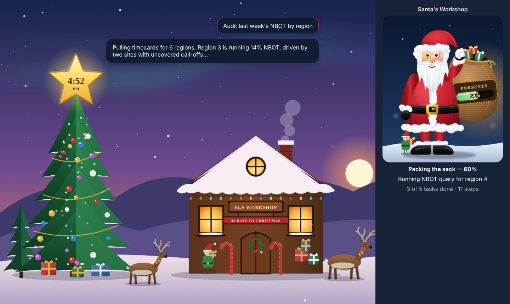

# Claude Code mods

Themes for the Claude desktop and mobile apps, built as Claude Code mods. They are not part of the Next.js app, and the root `tsconfig.json` excludes this folder.

## santa-workshop

A Christmas theme set at the North Pole.

- **Backdrop:** a decorated tree whose star shows the current time, an elf workshop with a countdown to Christmas, reindeer, and a sleigh crossing the sky. The sky changes with the hour (dawn, day, dusk, night). Point at a reindeer to make it hop, or at the tree to make its lights chase.
- **Santa pane:** Santa holds a sack with a fill gauge.
  - The gauge empties when a task starts and fills as it progresses. With a task list the fill is an exact count; without one it is an estimate that stops at 90%.
  - Presents rise out of the sack as it fills, and an elf runs one over on each step.
  - The pane shows what Claude is doing right now.
  - When a step fails, Santa looks puzzled and the workshop lights flicker.
  - When the task finishes, Santa dances.
- **Sound (off by default):** fireside crackle, a sleigh bell on finish and a low thud on error. Turn it on with the speaker button in the session's title bar.
- **Command:** `/santa` reopens the pane.
- **Time zone:** the clock and the sky follow `TIME_ZONE` in `hooks/register.tsx` (default `America/New_York`).

## clay-ivory

Ivory and clay colors in light and dark mode. Use one theme at a time: whichever loads last replaces the other.

## Install

This repository is a plugin marketplace named `claude-clone-mods`.

**In any Claude Code session opened on this repository** (cloud or local): nothing to do. `.claude/settings.json` adds the marketplace and turns on `santa-workshop`. Claude Code asks you to trust the repository's settings the first time.

**On your own computer, for every session.** At the prompt of a terminal session:

    /plugin install santa-workshop --marketplace ghamm20/anthropic-claude-clone-v1

From a shell:

    claude plugin install santa-workshop --marketplace ghamm20/anthropic-claude-clone-v1

In the desktop app, where `/plugin` does not run: click + next to the prompt box, then Plugins. Choose Add marketplace and enter `ghamm20/anthropic-claude-clone-v1`, then Add plugin and pick `santa-workshop`.

If the repository is private, your machine needs a GitHub credential first (`gh auth login`, then `gh auth setup-git`).

**Switch themes:** install `clay-ivory` the same way and disable `santa-workshop`. Only one theme shows at a time.

Themes draw only in the desktop and mobile apps. A terminal shows the plain progress bar instead.
